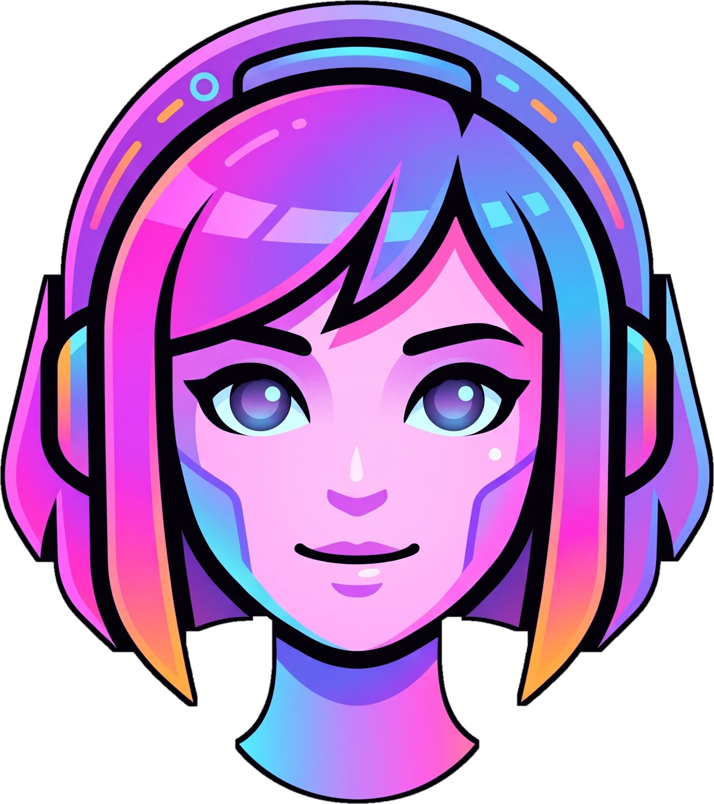

<p align="center">
  <a href="https://lucy.goatsoft.io">
    
  </a>
</p>

<h1 align="center">Lucy</h1>

<p align="center">
  <a href="https://lucy.goatsoft.io/docs/">Getting started</a> ·
  <a href="https://lucy.goatsoft.io/docs/components/">Components</a> ·
  <a href="https://lucy.goatsoft.io/docs/reactivity/">Reactivity</a> ·
  <a href="https://lucy.goatsoft.io/docs/architecture/">Architecture</a> ·
  <a href="https://lucy.goatsoft.io/docs/guide/agents/">Agents</a> ·
  <a href="https://lucy.goatsoft.io/docs/benchmarks/">Benchmarks</a>
</p>

<p align="center">A UI and app framework for Roblox, built on Universal Styling.</p>

<p align="center">
  <a href="https://github.com/goatsoft/lucy/actions/workflows/ci.yml"></a>
  <a href="https://lucy.goatsoft.io"></a>
  <a href="https://wally.run/package/goatsoft/lucy"></a>
  <a href="https://github.com/goatsoft/lucy/blob/main/LICENSE"></a>
</p>

## Overview

Lucy is a UI and app framework for Roblox. It gives you themed components and a
single place to keep your UI state.

Build UI screens from components and connect them to the app state. When a value
changes, Lucy updates only the properties that use it. Nothing is rebuilt, so
your app stays fast.

Menus and HUDs work with mouse, keyboard, gamepad and touch, on phone, desktop
and console, without handling each device yourself. Light and dark themes come
with it, and because the styling is Roblox's Universal Styling, hover effects
and theme switches run no Luau.

[Browse the components](https://lucy.goatsoft.io/docs/components/).

## Installation

### Wally

```toml
[dependencies]
Lucy = "goatsoft/lucy@0.2.0"
```

Run `wally install`. The examples below expect Lucy at
`ReplicatedStorage.Packages.Lucy`.

### Copy the source

To own and edit the components, copy them into your game with
[Lune](https://lune-org.github.io/docs) and a copy of this repo:

```sh
git clone https://github.com/goatsoft/lucy ~/Projects/Lucy
cd your-game
lune run ~/Projects/Lucy/scripts/add -- button dialog --from ~/Projects/Lucy --out src/shared/Lucy
```

The core and anything a component needs come along (Dialog brings Button).
`--all` copies every component.

### Coding agents

Lucy has skills for Claude Code, Codex and Antigravity, so an agent builds your
UI with Lucy's components. `@goatsoft/lucy-mcp` lets an agent see and press
your UI in Studio. See [Use Lucy with agents](https://lucy.goatsoft.io/docs/guide/agents/).

## Usage

Make one App on the client, then build scenes from components. This settings
menu has a volume slider the game reads and a theme picker that switches the
whole UI:

```lua
local ReplicatedStorage = game:GetService("ReplicatedStorage")
local SoundService = game:GetService("SoundService")
local Lucy = require(ReplicatedStorage.Packages.Lucy)

-- One app per player. Its state holds your game's data and the theme.
local app = Lucy.App.new({
    theme = "dark",
    state = { settings = { volume = 50 } },
})

app.scenes:register("Settings", {
    build = function(scene)
        Lucy.Stack.new({
            size = UDim2.fromScale(1, 1),
            align = "center",
            justify = "center",
            children = {
                Lucy.Panel.new({
                    title = "Settings",
                    maxWidth = 400,
                    children = {
                        -- Each control reads and writes a value in state.
                        Lucy.Text.new({ text = "Volume", variant = "label" }),
                        Lucy.Slider.new({ value = app.state:ref("settings.volume"), showValue = true }),
                        Lucy.Text.new({ text = "Theme", variant = "label" }),
                        Lucy.Select.new({
                            items = { { value = "dark", label = "Dark" }, { value = "light", label = "Light" } },
                            value = app.state:ref("theme"),
                        }),
                    },
                }),
            },
            Parent = scene.gui,
        })
    end,
})

app.scenes:goTo("Settings")

-- The game reads the same state.
app.state:subscribe("settings.volume", function(volume)
    SoundService.Music.Volume = volume / 100
end)
```

Every component keeps its state in the app, so game code can change any of it:

```lua
app.state:set("theme", "light")          -- switch theme
app.state:set("scenes.current", "Game")  -- change screen
app.toast.success("Round won", { description = "+$250" })
```

The [getting started guide](https://lucy.goatsoft.io/docs/) goes on from here:
[scenes](https://lucy.goatsoft.io/docs/guide/scenes/),
[app state](https://lucy.goatsoft.io/docs/guide/app-state/),
[themes](https://lucy.goatsoft.io/docs/guide/themes/),
[hotkeys](https://lucy.goatsoft.io/docs/guide/actions/) and the
[API](https://lucy.goatsoft.io/docs/reference/api/).

## Architecture

```
App            one per player, on the client
├─ state       all UI state in one tree of tables
├─ theme       Universal Styling rules for every component
├─ input       input mode, device, focus and the back button
├─ actions     named hotkeys for keyboard and gamepad
├─ scenes      one ScreenGui per screen, on layers
└─ toast       toast messages
```

A component keeps its state in the app at `ui.<id>`. It builds its instances
once and ties each property to the values it reads, so a change sets only those
properties. Code sets behaviour and layout; looks come from style rules matched
by tags. The [architecture guide](https://lucy.goatsoft.io/docs/architecture/)
has the rest.

## Licence

The code, docs, examples, stories and agent skills are
[MIT](https://github.com/goatsoft/lucy/blob/main/LICENSE). The Lucy name, Lucy
the mascot, the wordmark, the icons and the brand artwork in `assets/brand/` are
covered by the
[artwork and brand licence](https://github.com/goatsoft/lucy/blob/main/LICENSE-ART.md).
The games and UI you build with Lucy are yours.

---

<p align="center">
  <a href="https://goatsoft.io">
    <picture>
      <source media="(prefers-color-scheme: dark)" srcset="https://raw.githubusercontent.com/goatsoft/lucy/main/assets/brand/goatsoft/GOATsoft-masthead-light.png">
      
    </picture>
  </a>
  <br>
  Made by <a href="https://goatsoft.io">GOATsoft</a> · <a href="https://github.com/goatsoft/lucy/blob/main/LICENSE">MIT Licence</a> · <a href="https://github.com/goatsoft/lucy/blob/main/LICENSE-ART.md">Artwork licence</a>
</p>
